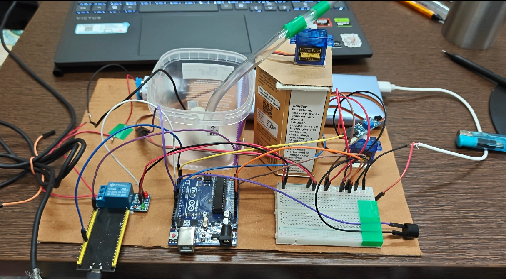
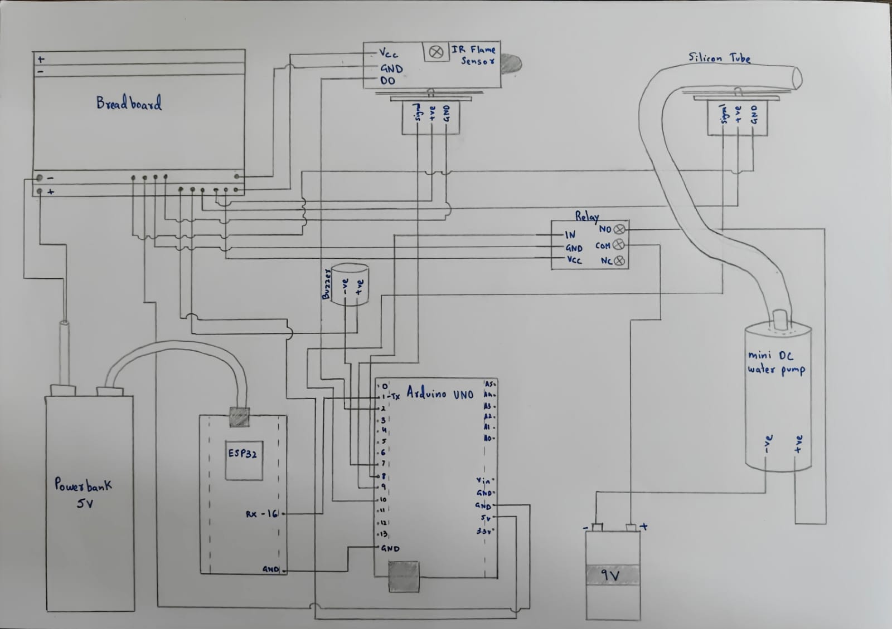

# Smart Fire Suppression System

An Arduino and ESP32 prototype that scans for a flame, directs a water nozzle, and displays a status page over Wi-Fi.



## Project overview

This project explores an automatic response to a detected flame. An Arduino Uno reads an infrared flame sensor and controls two servos, a relay-operated pump, and a buzzer. An ESP32 receives status messages from the Uno over serial and serves a simple web page on the local network.

**Status:** Educational prototype. This is not a certified fire protection system; do not rely on it for life safety or unattended fire suppression.

## Features

- Servo-driven flame scanning and nozzle positioning
- Pump and audible alert triggered by flame detection
- Local Wi-Fi status page using an ESP32
- Separate power sources for the control electronics and pump, as described in the project report

## Hardware

| Component | Role |
| --- | --- |
| Arduino Uno | Sensor and actuator control |
| ESP32 development board | Wi-Fi status page |
| IR flame sensor | Flame detection |
| Two servo motors | Position the sensor and water nozzle |
| Relay module and mini DC pump | Switch and deliver water |
| Buzzer | Audible indicator |
| Breadboard, power sources and tubing | Prototype assembly |

## System workflow

```text
Flame sensor → Arduino Uno → Servo motors / buzzer / relay → Water pump
                    └──────→ Serial → ESP32 → Local status page
```

The Arduino sketch sweeps the servos between 20° and 160°. On an active-low sensor reading it stops the sweep, turns on the buzzer and pump, and sends a detection message to the ESP32. The sketch runs the pump for at least 1.5 seconds and waits for the sensor to clear before resuming the scan. The ESP32 displays the latest serial status on a local web page.

## Circuit



The diagram and report are included as project documentation. **The report’s pin table and the Arduino sketch differ**, including sensor, relay and buzzer assignments. Confirm the actual wiring against the intended firmware before building or powering the system. The report and presentation also describe different pump power sources; the actual configuration has not been verified.

## Firmware

- [Arduino sketch](Firmware/arduino/arduino.ino): scanning, detection, relay and buzzer control.
- [ESP32 sketch](Firmware/esp/esp.ino): serial status receiver and local web server. Set your own Wi-Fi network name and password before uploading; placeholders are provided.

The sketches require the Arduino Servo library and ESP32 board support. The ESP32 sketch uses its WiFi and WebServer libraries. Firmware has not been independently built or tested for this repository.

## Repository structure

```text
Firmware/arduino/   Arduino control sketch
Firmware/esp/       ESP32 status-page sketch
Images/             Prototype photo and hand-drawn circuit
Docs/               Original project report and presentation
```

## Documentation

- [Project report](Docs/Smart%20Fire%20Suppression%20System%20Project.docx)
- [Project presentation](Docs/SMART%20FIRE%20SUPRESSION%20SYSTEM.pptx)

## Skills demonstrated

Embedded programming, sensor interfacing, servo control, relay switching, serial communication, and Wi-Fi web serving.

## Author

V Raj Narayanan
